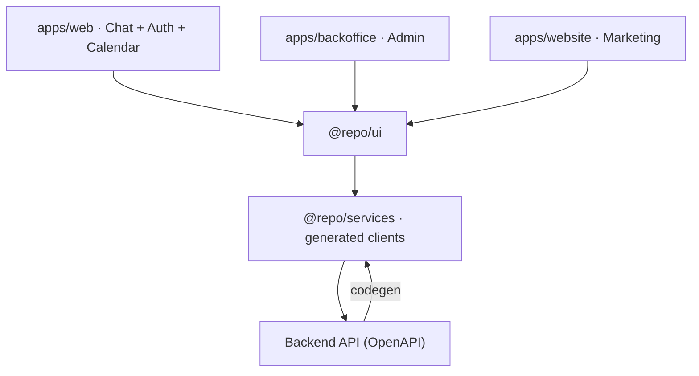

# ScheduleMate AI — Frontend

Frontend monorepo for **ScheduleMate AI**, an AI scheduling assistant that books Google Calendar meetings from natural-language chat — *"Book a meeting with Sarah Thursday at 3 PM"* — done.

## Tech stack

- **Next.js 16 + React 19** (App Router), **TypeScript 5.9** (strict)
- **Tailwind CSS 4** + **Radix UI / shadcn** primitives, **recharts**
- **@tanstack/react-query** (server state) + **Zustand** (client/UI state)
- **openapi-codegen** — type-safe API clients generated from the backend's OpenAPI docs
- **React Hook Form + Zod**, **Vitest + Testing Library** (`web`)
- **Turborepo + pnpm** workspaces

## Structure

```
apps/
  web/          # Product — AI chat, auth (email + Google), Google Calendar connect
  backoffice/   # Admin — dashboard, users, access requests, LLM/embedding config
  website/      # Marketing landing site + legal pages
packages/
  ui/           # Shared UI kit (primitives, charts, data-table, hooks, stores)
  services/     # Generated API clients + React Query hooks (@repo/services/<app>)
  eslint-config/
```

| App | Purpose | Port |
| --- | --- | --- |
| `apps/web` | Customer app: chat, sign-in (email/Google), Google Calendar connect | 3000 |
| `apps/backoffice` | Admin panel: analytics dashboard, user management, approvals, LLM config | 3001 |
| `apps/website` | Marketing site (hero, features, pricing, FAQ) | 3002 |

## Architecture



## How a chat message flows

1. User sends a message → `useChatActions` optimistically renders user + empty assistant bubbles (Zustand chat store, typing indicator).
2. `@repo/services` POSTs to the backend (`/api/chat/conversations/{id}/messages`) with `Authorization: Bearer` from the session cookie.
3. Backend returns `{ userMessage, assistantMessage, requestsRemaining }` in **one JSON response** (no streaming).
4. Chat + user queries are invalidated → refetch replaces optimistic bubbles with real messages.

## Auth

Custom, backend-owned cookie auth (not NextAuth): backend issues JWT access/refresh tokens → stored in cookies (`schedulemate-token`) → forwarded on every request; `queries-fetcher.ts` auto-refreshes on 401 and redirects to login. Google sign-in redirects through the backend; calendar connect requires admin approval (Google test mode).

## Run it

```sh
corepack enable && pnpm install
cp .env.sample .env        # set API base URLs + DOCS_AUTH_TOKEN
pnpm dev                   # all apps (3000–3002), or --filter=web|backoffice|website
```

| Command | Description |
| --- | --- |
| `pnpm dev` | All dev servers, watch mode |
| `pnpm build` | Production build, all workspaces |
| `pnpm lint` / `pnpm check-types` | Lint / type-check everywhere |
| `pnpm test` | Vitest (web) |
| `pnpm generate-types` | Regenerate API clients from backend OpenAPI |
| `pnpm <cmd> --filter=<app>` | Scope to one workspace |